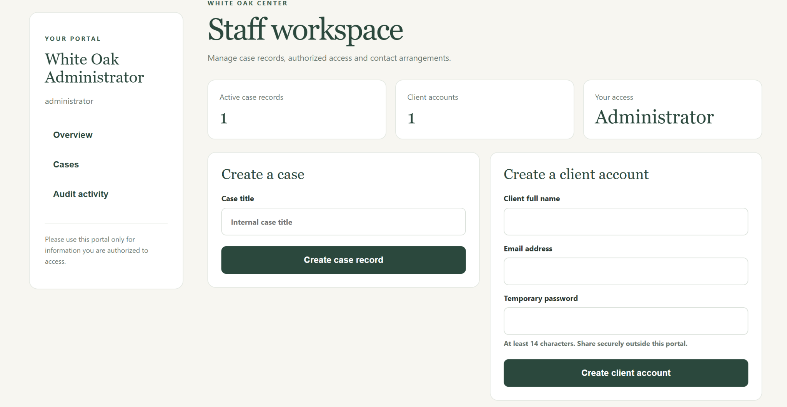
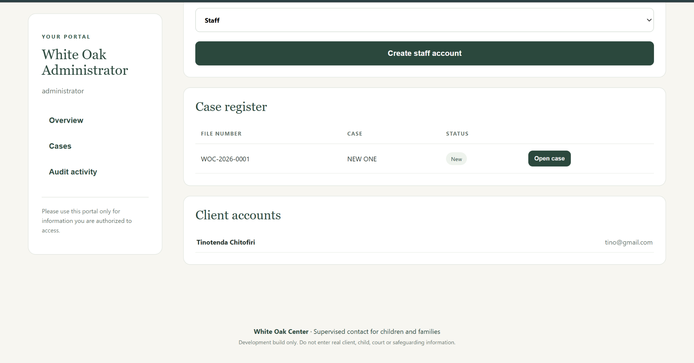

# White Oak Center – Client Portal

A web-based portal designed to help White Oak Center manage client accounts, case records, contact arrangements and document exchanges in one centralized workspace.

The portal provides separate working areas for authorized staff and clients, with access controlled by user roles and case-specific permissions.

## Portal overview

The portal supports two main user experiences:

- **Staff and administrator workspace:** manage client accounts, case records, case assignments, contact arrangements and documents.
- **Client portal:** allow clients to sign in, view information assigned to them, access documents shared with them and submit requested PDF documents.

## Screenshots

### Portal sign-in

The sign-in page provides the entry point for authorized staff and clients.

### Staff workspace

The staff workspace provides an overview of case records and client accounts, with tools to create cases and client accounts.

### Case register and client accounts

The case register displays file numbers and case status. The client accounts area lists client accounts managed through the portal.

## Main functionality

### Staff and administration

- Secure staff sign-in.
- Create and manage client accounts.
- Create and review case records.
- Assign clients to relevant cases.
- Manage case information and contact arrangements.
- Upload and manage PDF documents.
- Share selected documents with authorized clients.
- Record system activity through audit events.

### Client access

- Individual client sign-in.
- Access to assigned case information.
- View documents specifically shared with the client.
- Submit requested PDF documents.
- View relevant contact arrangements.

### Permissions and safeguarding controls

The application uses user roles and case-specific permissions to limit access to information. Safeguarding notes have additional restrictions and are not generally available to ordinary staff or clients.

## How the portal works

1. An administrator or authorized staff member creates a client account.
2. The client is assigned to the appropriate case.
3. Staff maintain the case record and upload relevant documents.
4. Staff decide which documents may be shared with the assigned client.
5. The client signs in and accesses permitted information.
6. The client can submit requested documents for staff review.

## Technology stack

| Technology | Role in the application |
|---|---|
| **Python** | Main backend programming language |
| **FastAPI** | Backend framework and API endpoints |
| **PostgreSQL** | Stores structured application data |
| **SQLAlchemy** | Object-relational mapping and database operations |
| **HTML5** | Frontend page structure |
| **CSS3** | Layout, styling and responsive presentation |
| **JavaScript** | Frontend interactions and API communication |
| **JWT** | Authentication token mechanism |
| **Cloudflare R2 / S3-compatible storage** | External storage for PDF documents |
| **Vercel** | Hosting and deployment platform |

### How the technologies work together

- The HTML, CSS and JavaScript frontend provides the staff and client interfaces.
- FastAPI receives frontend requests, applies application logic and enforces access permissions.
- SQLAlchemy connects the backend to PostgreSQL, where users, cases, referrals, contact sessions and audit events are stored.
- PDF documents are stored separately in private S3-compatible object storage.
- Vercel hosts the frontend and the Python API.

## Project purpose

The portal is intended to make case administration and document exchange more organized by providing staff and clients with a centralized digital workspace and controlled access to relevant information.

## Development status

This is a development build. It has not been independently certified or approved for real children's records, court documents or safeguarding information. Further legal, privacy, safeguarding and security review is required before live use.
