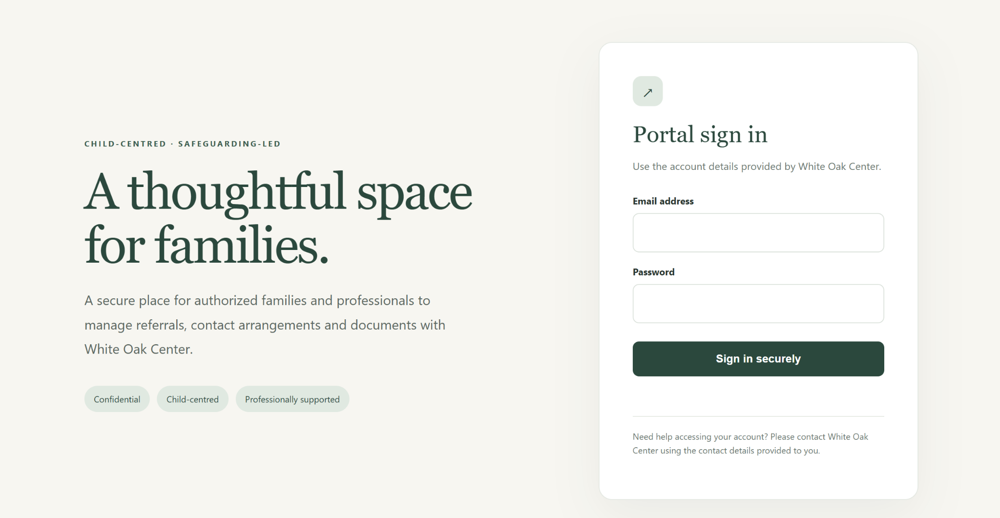

# White Oak Center – Client Portal

A secure, web-based client management portal designed to support White Oak Center in managing referrals, family contact arrangements, client records and document sharing.

The portal provides a central platform where authorized staff can manage cases and communicate relevant information with assigned clients through individual accounts.

## 1. About the System

The White Oak Center Client Portal simplifies the management of client information, referrals, case records and documents.

It provides two main working areas:

- **Staff and Administration Portal:** Allows authorized personnel to manage client accounts, case information, referrals, contact arrangements and documents.
- **Client Portal:** Allows clients to access their assigned case information, view documents shared with them and submit requested PDF documents.

The system uses role-based permissions to control access to information.

## 2. Main Features

### Administration and Staff Management

- Secure staff login.
- Create and manage client accounts.
- View and search client records.
- Assign clients to relevant cases.
- Manage case information and contact sessions.
- Upload, organize and manage PDF documents.
- Share selected documents with authorized clients.
- Maintain records of system activities.

### Client Portal

- Individual client login.
- Personal dashboard.
- View assigned case information.
- Access documents specifically shared with the client.
- Submit PDF documents.
- View relevant contact session arrangements.

### Case and Document Management

- Centralized case records.
- Unique case identification numbers.
- Client-to-case assignments.
- Controlled document visibility.
- PDF upload and download.
- Separate handling of restricted safeguarding notes.
- Audit event recording.

### Access Control and Safeguarding

The portal uses different user roles and permissions to restrict access to information.

Safeguarding notes have additional access restrictions and are not generally available to ordinary staff or clients.

## 3. How the Portal Works

The system follows a straightforward workflow:

1. An administrator or authorized staff member creates a client account.
2. The client is assigned to a relevant case.
3. Staff manage the case information and upload relevant documents.
4. Staff determine which documents can be shared with the assigned client.
5. The client signs in to their personal portal.
6. The client views authorized information and submits requested documents.
7. Staff access submitted documents and continue managing the case.

This workflow provides a centralized way to manage client records and document exchanges.

## 4. Technologies Used

| Technology | Purpose |
|---|---|
| Python | Main backend programming language |
| FastAPI | Backend framework and API development |
| PostgreSQL | Relational database for storing system records |
| SQLAlchemy | Database management and communication |
| JavaScript | Frontend interactions and API communication |
| HTML5 | Structure of the web application |
| CSS3 | Styling and responsive interface design |
| JWT | Authentication token management |
| Cloudflare R2 / S3-compatible storage | Private PDF document storage |
| Vercel | Application hosting and deployment |

### Why These Technologies?

**Python and FastAPI**

Used to develop the backend, manage application logic, handle authentication and provide API endpoints for the frontend.

**PostgreSQL**

Stores structured information such as users, client records, cases, referrals, contact sessions and audit events.

**SQLAlchemy**

Connects the application to PostgreSQL and manages database operations using Python models.

**HTML, CSS and JavaScript**

Provide the user interface, visual layout and interactive functionality of the portal.

**JWT Authentication**

Supports authenticated access to protected application endpoints.

**Cloudflare R2**

Provides external object storage for PDF documents, keeping uploaded files separate from the application server.

**Vercel**

Hosts the web interface and Python backend.

## 5. System Architecture

The portal uses a client-server architecture.

- The frontend provides the interface used by staff and clients.
- The FastAPI backend processes requests and applies application permissions.
- PostgreSQL stores structured application information.
- Private object storage holds uploaded PDF documents.
- The backend connects these components through API endpoints.

## 6. Screenshots

Screenshots of the application can be added here to demonstrate the interface and main functionality.

### Login Page

### Administrator Dashboard

### Client Dashboard

### Client Management

### Document Management

## 7. Project Purpose

The White Oak Center Client Portal was developed to improve the organization and management of client information, case records and document exchanges.

It provides a centralized digital environment for authorized staff and clients, with an emphasis on controlled access, organized records and efficient case administration.

---

**Project:** White Oak Center Client Portal  
**Backend:** Python / FastAPI  
**Frontend:** HTML / CSS / JavaScript  
**Database:** PostgreSQL  
**Deployment:** Vercel  
**File Storage:** Cloudflare R2 / S3-compatible storage

*Note: This is a development build. Its current functionality does not by itself establish regulatory compliance or readiness for real safeguarding, court or children's records.*
